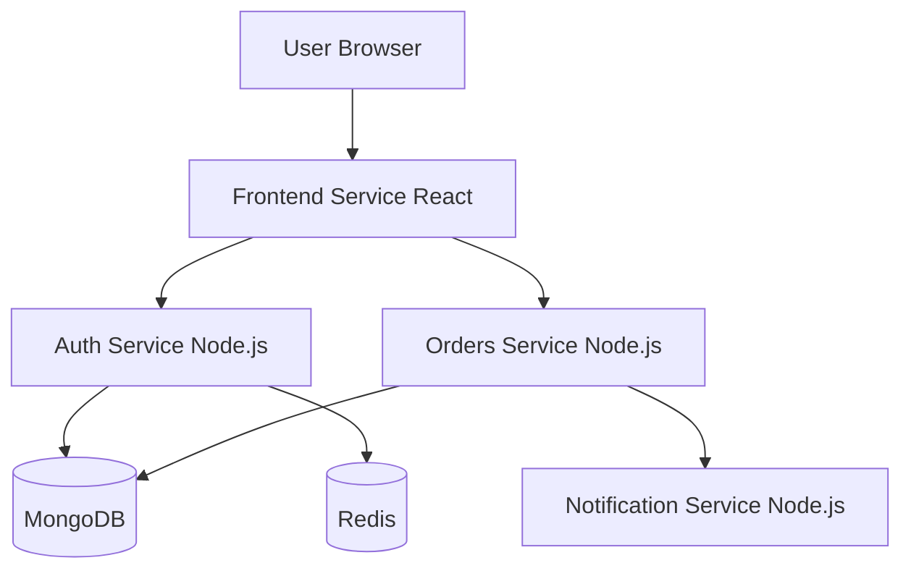
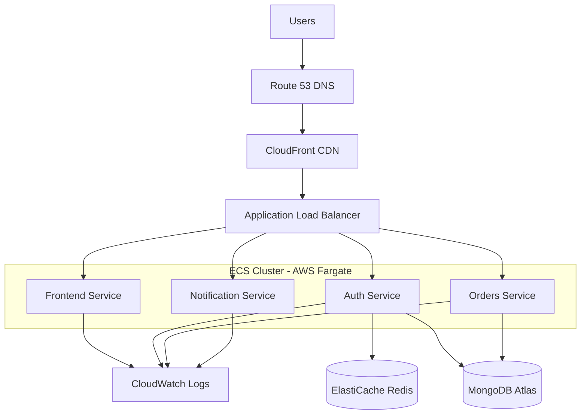
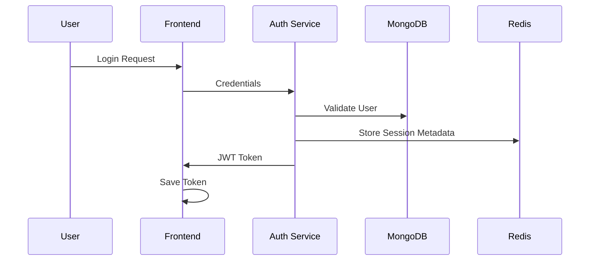

# 🚀 E-Commerce Microservices Platform on AWS

A cloud-native, containerized e-commerce platform built using a **microservices architecture** with **Node.js**, **React**, **Docker**, **MongoDB**, **Redis**, and **AWS ECS Fargate**.

This project demonstrates how to design, containerize, orchestrate, and deploy a scalable e-commerce platform using modern cloud engineering best practices.

---

## 📌 Table of Contents

* [Project Overview](#-project-overview)
* [Business Problem](#-business-problem)
* [Solution Overview](#-solution-overview)
* [System Architecture](#-system-architecture)
* [AWS Cloud Architecture](#-aws-cloud-architecture)
* [Microservices Architecture](#-microservices-architecture)
* [Technology Stack](#-technology-stack)
* [Features](#-features)
* [Project Structure](#-project-structure)
* [Authentication Flow](#-authentication-flow)
* [Redis Session Strategy](#-redis-session-strategy)
* [Database Design](#-database-design)
* [Local Development Setup](#-local-development-setup)
* [Docker Setup](#-docker-setup)
* [Docker Compose Setup](#-docker-compose-setup)
* [API Documentation](#-api-documentation)
* [Deployment Strategy](#-deployment-strategy)
* [Security Best Practices](#-security-best-practices)
* [Monitoring & Logging](#-monitoring--logging)
* [Future Improvements](#-future-improvements)
* [Screenshots](#-screenshots)
* [Author](#-author)

---

# 📖 Project Overview

This project is a **production-inspired cloud-native e-commerce platform** designed using a **microservices architecture** to simulate how modern digital commerce systems operate at scale.

The platform consists of:

* **Frontend Service** (React UI)
* **Authentication Service** (JWT + Redis)
* **Orders Service**
* **Notification Service**
* **MongoDB Database**
* **Redis Session Management**
* **Dockerized Services**
* **AWS Deployment Architecture**

The application demonstrates:

✅ Microservices Communication
✅ Stateless Authentication (JWT)
✅ Redis Session Metadata
✅ Docker Containerization
✅ Cloud-Native Architecture
✅ Scalable Infrastructure Design
✅ Secure API Communication
✅ Service Decoupling

---

# 🎯 Business Problem

Traditional monolithic e-commerce systems often suffer from:

* Tight coupling between services
* Poor scalability
* Difficult deployments
* Single points of failure
* High operational overhead

This project addresses those limitations through a **distributed microservices architecture** where each service is independently deployable, scalable, and maintainable.

---

# 💡 Solution Overview

The system decomposes the platform into dedicated services:

| Service              | Responsibility                          |
| -------------------- | --------------------------------------- |
| Frontend Service     | User Interface                          |
| Auth Service         | Registration, Login, JWT Authentication |
| Orders Service       | Product Retrieval & Checkout            |
| Notification Service | Email/Order Notifications               |
| Redis                | Session Metadata & Token Blacklisting   |
| MongoDB              | Persistent Storage                      |

---

# 🏗️ System Architecture



---

# ☁️ AWS Cloud Architecture

This project is designed to run on a **production-grade AWS architecture** using containerized microservices.



---

# 🧩 Microservices Architecture

The application follows a **service-oriented architecture**.

### Frontend Service

Responsible for:

* User interface
* Product display
* Authentication pages
* Checkout process

### Authentication Service

Responsible for:

* User registration
* User login
* JWT generation
* Password hashing
* Session metadata

### Orders Service

Responsible for:

* Product listing
* Checkout
* Order creation
* Refunds

### Notification Service

Responsible for:

* Order confirmation notifications
* Event-driven communication

---

# 🛠️ Technology Stack

## Frontend

* React
* Axios
* React Router DOM
* CSS3

## Backend

* Node.js
* Express.js
* JWT Authentication
* bcrypt.js

## Database

* MongoDB
* Mongoose ODM

## Cache Layer

* Redis

## DevOps

* Docker
* Docker Compose

## Cloud

* AWS ECS Fargate
* AWS ECR
* AWS CloudFront
* AWS Route 53
* AWS ALB
* AWS ElastiCache
* MongoDB Atlas
* AWS CloudWatch

---

# ✨ Features

## User Authentication

* User Registration
* User Login
* JWT Authentication
* Password Hashing
* Protected Sessions

## E-Commerce Features

* Product Listing
* Shopping Interface
* Checkout
* Order Processing
* Refund Capability

## Notification Features

* Order Confirmation
* Event-Based Notifications

## DevOps Features

* Dockerized Services
* Container Orchestration
* Multi-Service Communication
* Scalable Deployment

---

# 📂 Project Structure

```txt
E-commerce-Application/
│
├── frontend/
│   ├── src/
│   ├── public/
│   ├── Dockerfile
│   └── package.json
│
├── auth-service/
│   ├── controllers/
│   ├── middleware/
│   ├── models/
│   ├── routes/
│   ├── config/
│   ├── Dockerfile
│   └── server.js
│
├── orders-service/
│   ├── public/
│   ├── Dockerfile
│   └── server.js
│
├── notification-service/
│   ├── Dockerfile
│   └── server.js
│
├── docker-compose.yml
│
└── README.md
```

---

# 🔐 Authentication Flow

The platform uses **JWT-based authentication**.

### Authentication Process



---

# ⚡ Redis Session Strategy

This project uses Redis to support:

* Session Metadata
* JWT Token Blacklisting
* Fast Session Validation
* High-speed Authentication

Why Redis?

* Extremely fast
* In-memory performance
* Reduces DB lookups
* Supports distributed systems

---

# 🗄️ Database Design

MongoDB stores:

## Users Collection

```json
{
  "_id": "ObjectId",
  "name": "Saheed",
  "email": "saheed@test.com",
  "password": "hashed_password"
}
```

## Orders Collection

```json
{
  "id": "ORD-123456",
  "productId": 1,
  "productName": "Laptop",
  "quantity": 1,
  "amount": 899.99,
  "status": "completed"
}
```

---

# ⚙️ Local Development Setup

## Clone Repository

```bash
git clone https://github.com/yourusername/ecommerce-microservices.git
```

```bash
cd E-commerce-Application
```

---

## Install Dependencies

### Frontend

```bash
cd frontend
npm install
```

### Auth Service

```bash
cd auth-service
npm install
```

### Orders Service

```bash
cd orders-service
npm install
```

### Notification Service

```bash
cd notification-service
npm install
```

---

# 🐳 Docker Setup

Build services individually:

### Frontend

```bash
docker build -t frontend .
```

### Auth Service

```bash
docker build -t auth-service .
```

### Orders Service

```bash
docker build -t orders-service .
```

### Notification Service

```bash
docker build -t notification-service .
```

---

# 🐳 Docker Compose Setup

Start entire platform:

```bash
docker compose up --build
```

Run in detached mode:

```bash
docker compose up -d
```

Stop services:

```bash
docker compose down
```

---

# 🔌 API Documentation

## Auth Service

### Register User

```http
POST /api/auth/register
```

Request:

```json
{
  "name": "Saheed",
  "email": "saheed@test.com",
  "password": "password123"
}
```

---

### Login User

```http
POST /api/auth/login
```

Request:

```json
{
  "email": "saheed@test.com",
  "password": "password123"
}
```

---

## Orders Service

### Get Products

```http
GET /api/orders/products
```

### Checkout

```http
POST /api/orders/checkout
```

Request:

```json
{
  "productId": 1,
  "quantity": 1,
  "email": "saheed@test.com"
}
```

---

## Notification Service

### Send Notification

```http
POST /api/notifications/send
```

---

# 🚀 Deployment Strategy

The application is designed for deployment using:

### Container Registry

* AWS ECR

### Container Orchestration

* AWS ECS Fargate

### Database

* MongoDB Atlas

### Cache Layer

* AWS ElastiCache Redis

### Monitoring

* AWS CloudWatch

---

# 🔒 Security Best Practices

Implemented:

* Helmet.js
* Password Hashing
* JWT Authentication
* Environment Variables
* CORS Protection
* Redis Session Validation

Planned:

* HTTPS TLS Encryption
* AWS Secrets Manager
* Rate Limiting
* API Gateway Security
* MFA Authentication

---

# 📈 Monitoring & Logging

Cloud monitoring includes:

* Service Logs
* Health Checks
* CPU Metrics
* Memory Metrics
* Error Tracking

Tools:

* CloudWatch Logs
* CloudWatch Metrics

---

# 🔮 Future Improvements

Planned enhancements:

* Kubernetes Deployment
* CI/CD Pipeline
* Payment Gateway Integration
* Email Notifications
* Admin Dashboard
* Product Search
* Cart Persistence
* Order Tracking
* Event-Driven Messaging (SQS/SNS)


---

# 👨‍💻 Author

**Saheed Olatunde**

Cloud & DevOps Engineer | AWS Enthusiast | Full Stack Developer

---

## ⭐ If you found this project useful, consider starring the repository!

---

## 💬 Feedback

If you have any feedback, questions, or suggestions, please open an issue or reach out directly!

**Found this helpful? Give it a ⭐ and share it with others learning DevOps!**

---

Thanks you ....
very much 